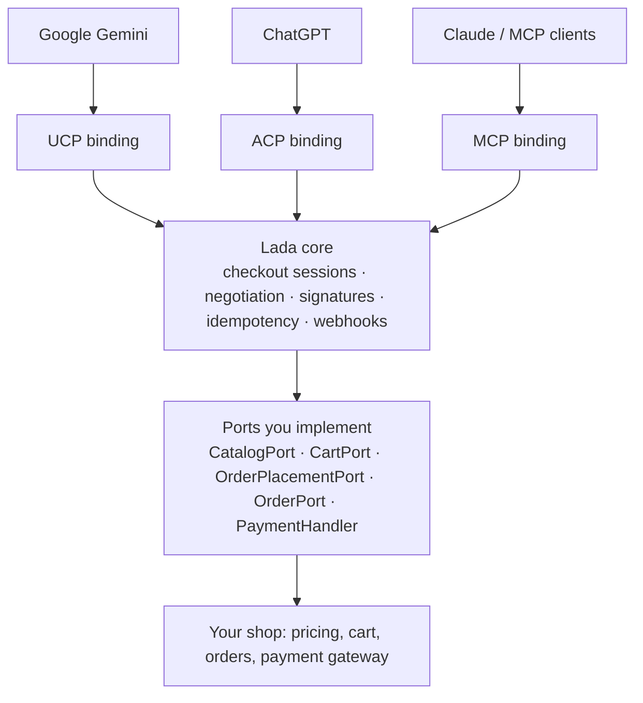

# Lada

**A storefront for AI agents.** Sell from your Symfony shop through Google Gemini, ChatGPT, Claude and any other AI agent — over UCP, ACP and MCP.

> **Status: planning.** No code yet. The design is in [docs/PLAN.md](docs/PLAN.md); feedback is welcome in issues.

## What it does

Lada lets any Symfony-based shop sell through AI agents, exposing your catalog, cart and checkout over **UCP** (Universal Commerce Protocol, used by Google Gemini and AI Mode), **ACP** (Agentic Commerce Protocol, used by ChatGPT) and **MCP** (Model Context Protocol, used by Claude and other MCP clients).

You implement a few small ports on top of your existing cart, pricing and order code, and Lada handles discovery, protocol negotiation, request signing, idempotency, the checkout state machine and order webhooks.

Your shop stays the single source of truth for prices and payments: **Lada never calculates totals or charges a card itself**, so every agent order follows the same path as a regular checkout.

## How it works



One protocol-agnostic core, three thin bindings. Purchase logic exists once; each protocol is just a different way in.

## Planned features

- **Discovery** — `/.well-known/ucp` profile with JWK signing keys, `/.well-known/acp.json`.
- **Catalog, cart, checkout and orders** over UCP and ACP REST, plus UCP/ACP-over-MCP.
- **Conversational MCP tools** (`search_products`, `start_checkout`, `place_order`, …) for any MCP client.
- **Payments through your own gateway** — UCP payment-handler tokens (e.g. Google Pay) and ACP Shared Payment Tokens are mapped onto your existing payment methods.
- **Cart handoff** — when native agent checkout isn't available, the agent builds the cart and the customer pays on your site.
- **Security by default** — RFC 9421 HTTP Message Signatures, replay protection, OAuth 2.1, constant-time token checks, SSRF-safe profile fetching.
- **Reliability** — atomic idempotency claims, transactional webhook outbox on Symfony Messenger.
- **Sylius bridge** as a ready-made reference integration.

## Packages (planned)

| Package | Purpose |
| --- | --- |
| `lada/core` | framework-free domain model, ports, checkout state machine |
| `lada/http-signatures` | RFC 9421 / RFC 9530 signing and verification |
| `lada/ucp` | Universal Commerce Protocol binding |
| `lada/acp` | Agentic Commerce Protocol binding |
| `lada/mcp` | Model Context Protocol tools and bindings |
| `lada/bundle` | Symfony bundle: routing, configuration, storage, Messenger |
| `lada/sylius-bridge` | ready-made adapters for Sylius |
| `lada/testkit` | fake shop, port contract tests, conformance runner |

## Integration preview

```yaml
# config/packages/lada.yaml
lada:
    ports:
        catalog: App\Agentic\CatalogAdapter
        cart: App\Agentic\CartAdapter
        order_placement: App\Agentic\OrderPlacementAdapter
        order: App\Agentic\OrderAdapter
    payment_handlers:
        - App\Agentic\Payment\GooglePayHandler
    protocols:
        ucp: { enabled: true, signatures: required }
        acp: { enabled: false }
        mcp: { enabled: true, auth: oauth }
```

## Roadmap

1. Foundation — core, HTTP signatures, testkit, bundle skeleton
2. UCP discovery and catalog
3. UCP cart and checkout handoff
4. MCP tools
5. Sylius bridge and first `0.x` release
6. UCP native checkout and webhooks
7. ACP
8. 1.0

Details, estimates and open decisions: [docs/PLAN.md](docs/PLAN.md).

## Requirements (planned)

PHP 8.3+, Symfony 7.x.

## Contributing

The project is in the design phase. Comments on the plan, protocol edge cases and integration needs are very welcome — open an issue.

## License

To be decided.
