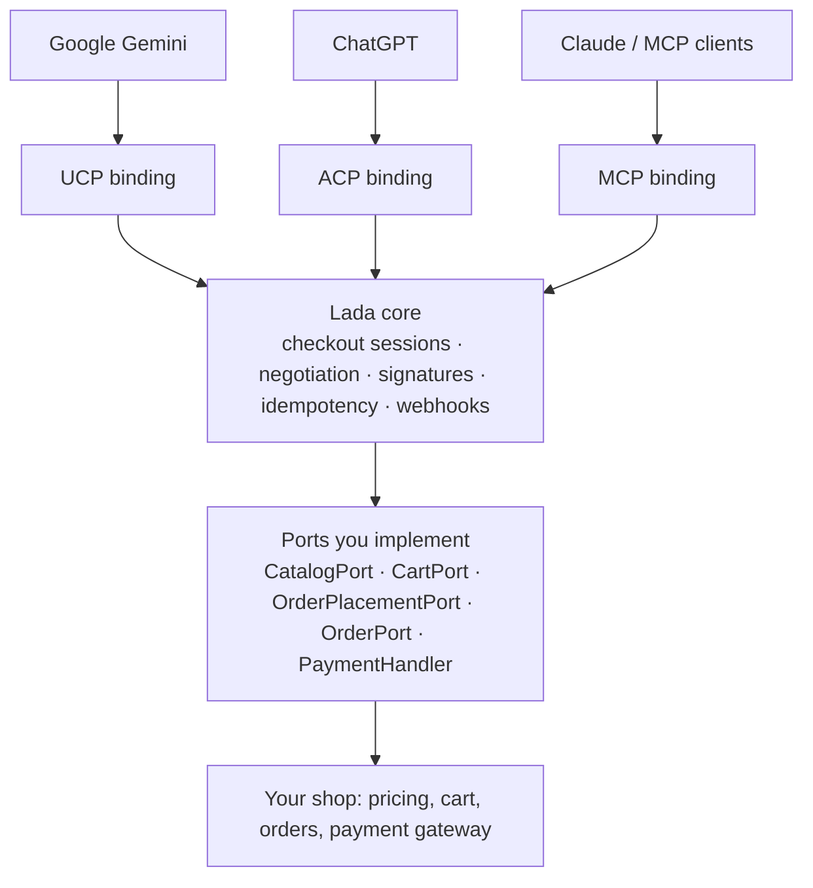

# Lada

**A storefront for AI agents.** Sell from your Symfony shop through Google Gemini, ChatGPT, Claude and any other AI agent — over UCP, ACP and MCP.

> **Status: in development.** The design is in [docs/PLAN.md](docs/PLAN.md), progress step by step in [docs/BACKLOG.md](docs/BACKLOG.md). Feedback is welcome in issues.

## What it does

Lada lets any Symfony-based shop sell through AI agents, exposing your catalog, cart and checkout over **UCP** (Universal Commerce Protocol, used by Google Gemini and AI Mode), **ACP** (Agentic Commerce Protocol, used by ChatGPT) and **MCP** (Model Context Protocol, used by Claude and other MCP clients).

You implement a few small ports on top of your existing cart, pricing and order code, and Lada handles discovery, protocol negotiation, request signing, idempotency, the checkout state machine and order webhooks.

Your shop stays the single source of truth for prices and payments: **Lada never calculates totals or charges a card itself**, so every agent order follows the same path as a regular checkout.

## How it works



One protocol-agnostic core, three thin bindings. Purchase logic exists once; each protocol is just a different way in.

## Planned features

- **Discovery** — `/.well-known/ucp` profile with JWK signing keys, `/.well-known/acp.json`.
- **Catalog, cart, checkout and orders** over UCP and ACP REST, plus UCP/ACP-over-MCP.
- **Conversational MCP tools** (`search_products`, `start_checkout`, `place_order`, …) for any MCP client.
- **Payments through your own gateway** — UCP payment-handler tokens (e.g. Google Pay) and ACP Shared Payment Tokens are mapped onto your existing payment methods.
- **Cart handoff** — when native agent checkout isn't available, the agent builds the cart and the customer pays on your site.
- **Security by default** — RFC 9421 HTTP Message Signatures, replay protection, OAuth 2.1, constant-time token checks, SSRF-safe profile fetching.
- **Reliability** — atomic idempotency claims, transactional webhook outbox on Symfony Messenger.
- **Sylius bridge** as a ready-made reference integration.

## Packages (planned)

| Package | Purpose |
| --- | --- |
| `lada/core` | framework-free domain model, ports, checkout state machine |
| `lada/http-signatures` | RFC 9421 / RFC 9530 signing and verification |
| `lada/ucp` | Universal Commerce Protocol binding |
| `lada/acp` | Agentic Commerce Protocol binding |
| `lada/mcp` | Model Context Protocol tools and bindings |
| `lada/bundle` | Symfony bundle: routing, configuration, storage, Messenger |
| `lada/sylius-bridge` | ready-made adapters for Sylius |
| `lada/testkit` | fake shop, port contract tests, conformance runner |

## Integration preview

```yaml
# config/packages/lada.yaml
lada:
    ports:
        catalog: App\Agentic\CatalogAdapter
        cart: App\Agentic\CartAdapter
        order_placement: App\Agentic\OrderPlacementAdapter
        order: App\Agentic\OrderAdapter
    payment_handlers:
        - App\Agentic\Payment\GooglePayHandler
    protocols:
        ucp: { enabled: true, signatures: required }
        acp: { enabled: false }
        mcp: { enabled: true, auth: oauth }
```

## Usage

> The packages are not published yet. This section grows with every implemented step and only documents what already works.

### Installation

```bash
composer require lada/core
```

### Money

Every amount in Lada is a `Money` in **minor units** (grosze, cents) of one currency. Lada never computes prices — `Money` only carries amounts reported by your shop and compares them.

```php
use Lada\Core\Domain\Shared\Currency;
use Lada\Core\Domain\Shared\Money;

$pln = Currency::of('PLN');                 // ISO 4217, throws InvalidCurrency otherwise

$unitPrice = Money::of(12_99, $pln);        // 12.99 PLN
$lineTotal = $unitPrice->multiply(3);       // 38.97 PLN
$total     = $lineTotal->add(Money::of(15_00, $pln));

$total->equals(Money::of(53_97, $pln));     // true
$total->isGreaterThan(Money::zero($pln));   // true
$total->add(Money::of(1, Currency::of('EUR'))); // throws CurrencyMismatch
```

`Money` is immutable; every operation returns a new instance.

### Identifiers

Your shop keeps its own identifiers; Lada wraps them in typed, immutable value objects and never interprets them.

```php
use Lada\Core\Domain\Cart\CartRef;
use Lada\Core\Domain\Catalog\ProductRef;
use Lada\Core\Domain\Checkout\CheckoutSessionId;
use Lada\Core\Domain\Order\OrderRef;
use Lada\Core\Domain\Shared\IdempotencyKey;

$cart    = new CartRef('42');            // your cart id
$order   = new OrderRef('2026/10/0001');   // your order number
$product = new ProductRef('SKU-123');    // SKU or variant code

$order->value;                           // '2026/10/0001'
$cart->equals(new CartRef('42'));        // true
$cart->equals(new OrderRef('42'));       // false — different kinds never match

$session = CheckoutSessionId::generate();              // UUID v4 generated by Lada
$session = CheckoutSessionId::fromString($fromRequest); // restore from a request

$key = IdempotencyKey::fromString($request->headers->get('Idempotency-Key'));
```

| Type | Accepts | Owner |
| --- | --- | --- |
| `CartRef`, `OrderRef`, `ProductRef` | 1–255 characters, no surrounding whitespace | your shop |
| `CheckoutSessionId` | UUID (stored lowercase) | Lada |
| `IdempotencyKey` | 1–255 visible ASCII characters (header-safe) | the agent; forwarded to your shop and payment gateway |

Invalid values throw `InvalidIdentifier`. The protocol a request came through is the `Protocol` enum (`Ucp`, `Acp`, `Mcp`).

### Cart snapshot

Your cart adapter describes the state of your cart as a `CartSnapshot`. It is **the only source of prices in Lada**: every amount comes from your pricing engine, Lada only passes it on and compares it.

```php
use Lada\Core\Domain\Cart\{CartLine, CartRef, CartSnapshot, FulfillmentOption, LineRef, Message, Requirement, Severity, Totals};
use Lada\Core\Domain\Catalog\ProductRef;
use Lada\Core\Domain\Shared\{Currency, Money};

$pln = Currency::of('PLN');

$snapshot = new CartSnapshot(
    ref: new CartRef((string) $cart->getId()),
    lines: [
        new CartLine(
            ref: new LineRef('1'),
            product: new ProductRef('MUG-RED'),
            title: 'Red mug',
            quantity: 2,
            unitPrice: Money::of(39_00, $pln),
            total: Money::of(70_00, $pln),          // after line discount — your number, not recomputed
        ),
    ],
    totals: new Totals(
        subtotal: Money::of(70_00, $pln),
        discount: Money::of(0, $pln),
        shipping: Money::of(15_99, $pln),
        tax: Money::of(16_08, $pln),
        total: Money::of(85_99, $pln),
    ),
    fulfillmentOptions: [
        new FulfillmentOption('inpost', 'InPost Paczkomat', Money::of(15_99, $pln), '1–2 days'),
        new FulfillmentOption('pickup', 'Pickup in store', Money::of(0, $pln)),
    ],
    selectedFulfillmentOptionId: 'inpost',
    messages: [
        new Message(Severity::Warning, 'low_stock', 'Only 3 left.', '$.line_items[0]'),
    ],
    missing: [Requirement::BuyerEmail],
);
```

- `messages` tell the agent what is wrong. `Severity` decides what happens next: `Info` and `Warning` never block, `Recoverable` blocks until the agent fixes it, `RequiresBuyerInput` / `RequiresBuyerReview` block until the buyer acts (Lada escalates to the buyer).
- `missing` lists data you still need before placing the order (`BuyerEmail`, `ShippingAddress`, `BillingAddress`, `FulfillmentOption`). Payment is not on the list — the agent hands it over together with the request to complete the checkout.
- The snapshot validates itself: one currency everywhere, unique line and option ids, a selected option that is actually offered. A violation throws `InvalidCart` or `CurrencyMismatch`.

### Channel and catalog

A `Channel` describes what agents see: currency, language and market. Every catalog request carries a `PricingContext` — the channel plus the country the goods ship to — so your shop can price and tax products the same way it does for its own storefront.

```php
use Lada\Core\Domain\Catalog\{Availability, PricingContext, Product, ProductPage, ProductRef, SearchQuery};
use Lada\Core\Domain\Shared\{Channel, Country, Currency, Money, Url};

$channel = new Channel(
    code: 'default',                  // [a-z0-9_-], up to 64 characters
    currency: Currency::of('PLN'),
    locale: 'pl_PL',                  // "pl" or "pl_PL"
    country: Country::of('PL'),       // ISO 3166-1 alpha-2
);

$context = PricingContext::forChannel($channel);          // ships to PL
$toGermany = $context->shippingTo(Country::of('DE'));     // new instance, original unchanged
```

An agent's search reaches your shop as a `SearchQuery`; you answer with a `ProductPage` ranked by **your** search engine:

```php
$query->text;     // 'red mug', or null to browse
$query->limit;    // 1–100, default 20
$query->cursor;   // null for the first page, otherwise your own cursor from the previous page

$page = new ProductPage(
    products: [
        new Product(
            ref: new ProductRef('MUG-RED'),
            title: 'Red mug',
            price: Money::of(39_00, $channel->currency),        // final price for this context
            availability: Availability::InStock,              // InStock, OutOfStock, BackOrder, PreOrder
            url: Url::of('https://shop.example/red-mug'),
            description: 'Ceramic, 330 ml',
            listPrice: Money::of(49_00, $channel->currency),    // optional "was" price
            images: [Url::of('https://shop.example/img/red-mug.jpg')],
        ),
    ],
    nextCursor: 'opaque-cursor-for-page-2',                   // null on the last page
);
```

`Url` accepts only absolute `http(s)` URLs, because agents can't resolve relative links. Invalid input throws `InvalidChannel`, `InvalidCountry`, `InvalidUrl` or `InvalidCatalog`.

### Checkout status

You never set a checkout status yourself. Lada derives it from your `CartSnapshot` — you say *what* is wrong, Lada decides *who* has to act:

| Your snapshot contains | Status | Who acts |
| --- | --- | --- |
| a message with `RequiresBuyerInput` or `RequiresBuyerReview` | `RequiresEscalation` | the buyer (the agent hands over) |
| no lines, anything in `missing`, or a `Recoverable` message | `Incomplete` | the agent (adds data, picks another option) |
| none of the above (`Info` / `Warning` messages are fine) | `ReadyForComplete` | the agent may complete with a payment |

Escalation wins over everything else: if the buyer has to act, missing data does not matter yet. The remaining statuses — `CompleteInProgress`, `Completed`, `Canceled`, `Expired` — follow from the checkout lifecycle; the last three are final (`CheckoutStatus::isFinal()`). Protocol bindings map these statuses onto UCP's and ACP's own ones.

### Cart draft

When an agent creates or updates a cart, your adapter receives a `CartDraft`: the **complete** state the agent wants (always a full replacement, never a patch). You apply it to your own cart and answer with a `CartSnapshot`.

```php
$draft->lines;                 // list<DraftLine>: ProductRef + quantity (> 0) — no prices, those are yours
$draft->buyer->email;          // ?Email (validated)
$draft->buyer->fullName;       // ?string
$draft->buyer->phone;          // ?string
$draft->shippingAddress;       // ?Address: name, street, city, postalCode, Country, streetLine2, region, phone
$draft->billingAddress;        // ?Address
$draft->fulfillmentOptionId;   // ?string — one of the ids you offered in the snapshot
$draft->discountCodes;         // list<string>
```

Agents collect buyer data step by step, so every buyer field is optional. Report what you still need in `CartSnapshot::$missing`.

### Payment

Agents hand over payment credentials (Google Pay token, ACP Shared Payment Token) as a `PaymentInstrument`. **Lada never charges it.** A `PaymentHandler` (see [Implementing the ports](#implementing-the-ports)) translates it into a `GatewayPayment`, which is one of *your* payment methods plus the data *your* gateway expects:

```php
use Lada\Core\Domain\Payment\GatewayPayment;

$instrument->handlerId;     // 'com.google.pay'
$instrument->token;         // the credential
$instrument->brand;         // 'visa' — display only
$instrument->lastDigits;    // '4242' — display only

$payment = new GatewayPayment('stripe', [
    'payment_method_data' => ['shared_payment_granted_token' => $instrument->token],
]);
```

Both classes mask credentials in `var_dump()` / `print_r()` output, so tokens don't leak into logs.

### Placing the order

Your order placement adapter places the order through your regular checkout path and reports the outcome as a `PlacementResult`:

```php
use Lada\Core\Domain\Order\{OrderRef, PlacementResult};
use Lada\Core\Domain\Shared\Url;

PlacementResult::placed(new OrderRef('2026/10/0001'));                // order created, payment accepted
PlacementResult::requiresAction(Url::of('https://psp.example/3ds')); // buyer must finish (3-D Secure, hosted page)
PlacementResult::declined('Insufficient funds');                    // no order
PlacementResult::totalChanged($currentCartSnapshot);                // price changed — nothing charged
PlacementResult::outOfStock([new LineRef('1')]);                    // lines no longer available — nothing charged
```

Lada maps each outcome to the right protocol status and message. Orders are reported back as an `OrderSnapshot`: `ref`, `status` (`Placed`, `Paid`, `Shipped`, `Delivered`, `Canceled`, `Refunded`), `lines`, `totals`, `placedAt` and an optional status-page `url`.

### Implementing the ports

Your shop plugs into Lada through five interfaces in `Lada\Core\Application\Port`. Implement them on top of your existing code — the same pricing, cart and checkout your storefront uses.

| Port | You implement | Notes |
| --- | --- | --- |
| `CatalogPort` | `search(SearchQuery): ProductPage`, `lookup(list<ProductRef>, PricingContext): list<Product>` | rank with your search engine; skip unknown refs in `lookup` |
| `CartPort` | `create(CartDraft, PricingContext)`, `replace(CartRef, CartDraft)`, `get(CartRef)` → `CartSnapshot`; `release(CartRef)` | `replace` is a full replacement and must be idempotent; throw `CartNotFound` for unknown carts |
| `OrderPlacementPort` | `place(CartRef, GatewayPayment, Buyer, IdempotencyKey): PlacementResult` | your regular checkout path; forward the idempotency key to your PSP |
| `OrderPort` | `get(OrderRef): OrderSnapshot` | throw `OrderNotFound` for unknown orders |
| `PaymentHandler` | `id()`, `describe(Channel)`, `toGatewayPayment(PaymentInstrument, CartSnapshot)` | one per accepted agent payment method; never calls a PSP |

Example order placement on top of a command bus:

```php
use Lada\Core\Application\Port\OrderPlacementPort;
use Lada\Core\Domain\Buyer\Buyer;
use Lada\Core\Domain\Cart\CartRef;
use Lada\Core\Domain\Order\{OrderRef, PlacementResult};
use Lada\Core\Domain\Payment\GatewayPayment;
use Lada\Core\Domain\Shared\{IdempotencyKey, Url};

final readonly class OrderPlacementAdapter implements OrderPlacementPort
{
    public function __construct(private MessageBusInterface $commandBus) {}

    public function place(CartRef $ref, GatewayPayment $payment, Buyer $buyer, IdempotencyKey $key): PlacementResult
    {
        try {
            $orderId = $this->commandBus->dispatch(new PlaceOrder(
                cartId: $ref->value,
                paymentMethod: $payment->method,
                paymentData: $payment->data,
                customerEmail: $buyer->email?->value,
                idempotencyKey: $key->value,
            ))->last(HandledStamp::class)->getResult();

            return PlacementResult::placed(new OrderRef($orderId));
        } catch (PaymentRequiresRedirect $e) {
            return PlacementResult::requiresAction(Url::of($e->redirectUrl));
        } catch (PaymentDeclined $e) {
            return PlacementResult::declined($e->getMessage());
        }
    }
}
```

Example payment handler mapping a Google Pay token onto your Stripe payment method:

```php
use Lada\Core\Application\Port\PaymentHandler;
use Lada\Core\Domain\Cart\CartSnapshot;
use Lada\Core\Domain\Payment\{GatewayPayment, PaymentInstrument};
use Lada\Core\Domain\Shared\Channel;

final readonly class GooglePayHandler implements PaymentHandler
{
    public function id(): string
    {
        return 'com.google.pay';
    }

    public function describe(Channel $channel): array
    {
        return ['merchant_id' => 'BCR2DN4T…', 'allowed_card_networks' => ['VISA', 'MASTERCARD']];
    }

    public function toGatewayPayment(PaymentInstrument $instrument, CartSnapshot $cart): GatewayPayment
    {
        return new GatewayPayment('stripe', ['payment_method_data' => ['type' => 'card', 'card' => ['token' => $instrument->token]]]);
    }
}
```

Lada keeps the handlers in a `PaymentHandlerRegistry` and picks the right one by `PaymentInstrument::$handlerId` (`UnknownPaymentHandler` if none matches, `DuplicatePaymentHandler` if two share an id).

### Errors

Every exception thrown by Lada implements `Lada\Core\Domain\Exception\LadaException`, so you can catch them in one place.

## Roadmap

1. Foundation — core, HTTP signatures, testkit, bundle skeleton
2. UCP discovery and catalog
3. UCP cart and checkout handoff
4. MCP tools
5. Sylius bridge and first `0.x` release
6. UCP native checkout and webhooks
7. ACP
8. 1.0

Details, estimates and open decisions: [docs/PLAN.md](docs/PLAN.md). Step-by-step progress: [docs/BACKLOG.md](docs/BACKLOG.md).

## Requirements

PHP 8.5+, Symfony 7.x (bundle only — the core and protocol packages are framework-free).

## Contributing

Architecture rules, coding standards and the test convention are in [CONTRIBUTING.md](CONTRIBUTING.md). Comments on the plan, protocol edge cases and integration needs are very welcome — open an issue.

## License

To be decided.
