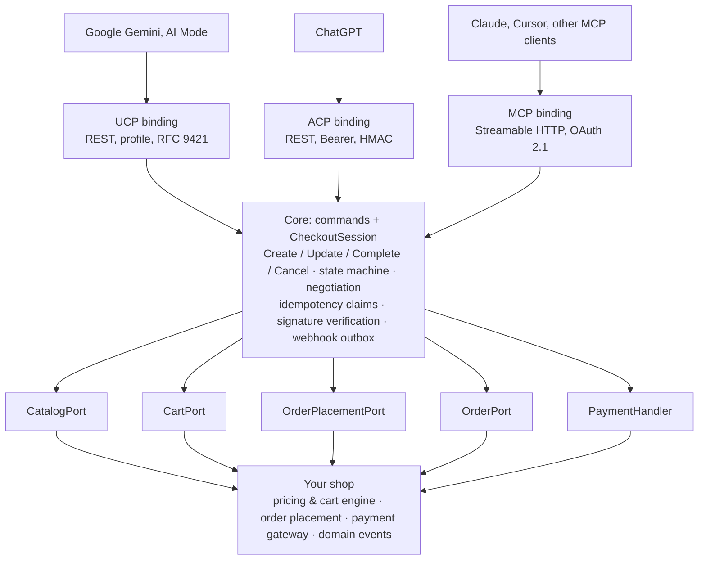

# Lada — implementation plan

Status: draft, 2026-10-14. Nothing is implemented yet; this document describes what will be built and in what order.

## 1. Goal and scope

Lada gives a Symfony-based shop one agent-commerce core and three thin protocol bindings: **UCP**, **ACP** and **MCP**. The shop implements a handful of ports on top of its existing cart, pricing and order code; Lada does the rest — discovery, negotiation, request signing, idempotency, the checkout-session state machine and order webhooks.

**Ground rule: Lada never calculates prices and never charges a card on its own.** Totals come from the shop's pricing engine and payment goes through the shop's existing gateway, in the same code path as a regular checkout. Every critical bug we found in existing open-source agent-commerce modules (see [§11](#11-lessons-from-existing-implementations)) came from breaking this rule.

**In scope**

- Discovery: `/.well-known/ucp` (with JWK signing keys) and `/.well-known/acp.json`.
- Catalog (search, lookup), cart, checkout session (create, get, update, complete, cancel), order.
- Payment tokens from UCP payment handlers and ACP Shared Payment Tokens, handed over to the shop's gateway.
- RFC 9421 + Content-Digest (UCP), Bearer + HMAC (ACP), OAuth 2.1 (MCP, identity linking).
- Idempotency with atomic claims; webhooks delivered through Symfony Messenger.
- An MCP server with buyer-facing tools.

**Out of scope for now**: AP2 mandates, A2A and Embedded transports, split payments, accepting raw cards (delegated payment on the merchant side), admin UI.

## 2. Architecture

Ports and adapters: protocol bindings are inbound adapters, the shop plugs in through outbound ports, and the core knows neither the protocol nor the framework.



Orders flow back up as an `OrderLifecycleEvent` (dispatched by the shop on the Messenger bus) and leave towards agents as webhooks from the core's outbox.

## 3. Packages

A monorepo split into separate Composer packages (via `symplify/monorepo-builder` or `splitsh-lite`). Core and protocol packages are framework-free; Symfony lives only in the bundle. The core can be tested in isolation and a protocol can be swapped without touching the shop.

| Package | Contents | Depends on |
| --- | --- | --- |
| `lada/core` | session model, state machine, ports, domain exceptions, `Money` in minor units | PHP 8.3, `psr/clock`, `psr/log` |
| `lada/http-signatures` | RFC 9421 signing and verification, RFC 9530 Content-Digest, JWK (ES256, ES384, Ed25519) | `ext-openssl`, `ext-sodium` (or `web-token/jwt-library`) |
| `lada/ucp` | profile, negotiation, UCP ↔ core schema mapping, error codes | core, http-signatures |
| `lada/acp` | discovery, `API-Version`, ACP session ↔ core mapping, webhook HMAC | core |
| `lada/mcp` | buyer tools, UCP-over-MCP and ACP-over-MCP bindings | core, `mcp/sdk` |
| `lada/bundle` | routing, raw-body controllers, DI, configuration, Doctrine stores, Messenger, OAuth | Symfony 7.x, `symfony/mcp-bundle`, `league/oauth2-server-bundle` |
| `lada/sylius-bridge` | ready-made port adapters for Sylius — reference implementation and test bed | bundle, Sylius 2.x |
| `lada/testkit` | in-memory fake shop, fixtures, conformance runner | core |

`lada/http-signatures` is worth shipping as a standalone product: PHP has no mature RFC 9421 library, and it is useful outside commerce (e.g. Web Bot Auth).

## 4. Domain model and ports

The checkout session inside Lada is thin: it holds a reference to the shop's cart and derives its status from the cart state. It never copies line items or totals.

### `CheckoutSession` aggregate

- `id`, `protocol` (ucp / acp / mcp), `negotiated` (version and capabilities), `cartRef`, `orderRef`, `buyer`, `status`, `expiresAt`, `continueUrl`.
- `status` is a core enum: `Incomplete`, `RequiresEscalation`, `ReadyForComplete`, `CompleteInProgress`, `Completed`, `Canceled`, `Expired`. Bindings map it to UCP's 6 and ACP's 11 statuses.
- Transitions are guarded by the aggregate (no update while `CompleteInProgress`, no cancel after `Completed`). Status is derived from the `CartSnapshot`: all required data present and no blocking messages → `ReadyForComplete`.

### Ports implemented by the shop

```php
interface CatalogPort
{
    public function search(SearchQuery $query): ProductPage;

    /** @param list<ProductRef> $refs */
    public function lookup(array $refs, PricingContext $ctx): array;
}

interface CartPort
{
    public function create(CartDraft $draft, PricingContext $ctx): CartSnapshot;

    /** Full replacement of the cart state — the shop maps it onto its own steps. */
    public function replace(CartRef $ref, CartDraft $draft): CartSnapshot;

    public function get(CartRef $ref): CartSnapshot;

    public function release(CartRef $ref): void;
}

interface OrderPlacementPort
{
    /** Places the order through the shop's regular checkout path; the gateway charges. */
    public function place(CartRef $ref, GatewayPayment $payment, Buyer $buyer, IdempotencyKey $key): PlacementResult;
}

interface OrderPort
{
    public function get(OrderRef $ref): OrderSnapshot;
}

interface PaymentHandler
{
    public function id(): string;                        // e.g. com.google.pay, dev.acp.tokenized.card
    public function describe(Channel $channel): array;   // entry for the profile / capabilities
    public function toGatewayPayment(PaymentInstrument $instrument, CartSnapshot $cart): GatewayPayment;
}
```

- `CartSnapshot`: lines with unit and line totals, `Totals` (subtotal, discount, shipping, tax, total) in minor units, fulfillment options, `messages` with severity, completeness flags (address, shipping, payment). **The only source of prices.**
- `PlacementResult`: `Placed(OrderRef)`, `RequiresAction(continueUrl)` (3DS, hosted page), `Declined(reason)`, `TotalChanged(CartSnapshot)`, `OutOfStock(lines)`. Lada translates these into protocol messages and statuses.
- `PaymentHandler` never calls a PSP. It only translates a token (Google Pay, SPT) into the shop's payment-method data, e.g. `stripe` + `payment_method_data[shared_payment_granted_token]`.

### Infrastructure ports (default implementations in the bundle)

| Port | Default | Notes |
| --- | --- | --- |
| `CheckoutSessionRepository` | Doctrine DBAL | TTL, cleanup via scheduler |
| `IdempotencyStore` | DBAL, unique key + claim row | atomic `claim()` before execution |
| `KeyStore` | files / Symfony Secrets | time-based rotation grace period |
| `PlatformProfileFetcher` | `HttpClient` + PSR-6 cache | SSRF protection with pinned IP |
| `ReplayGuard` | Redis / DBAL | signature cache within the `created`–`expires` window |
| `WebhookOutbox` | Doctrine + Messenger | async delivery with retries |

### Events from the shop

The shop dispatches `OrderLifecycleEvent` (created, paid, shipped, delivered, refunded, canceled) on the Messenger bus. In a shop with its own event stream (Kafka, RabbitMQ) this is a single consumer translating existing domain events; Lada picks webhook recipients by `orderRef`.

## 5. Protocol bindings

Each binding is an inbound adapter: it parses the request, authenticates, calls the same core commands (`CreateCheckout`, `UpdateCheckout`, `CompleteCheckout`, `CancelCheckout`, `SearchCatalog`, `GetOrder`) and serializes the result its own way. Purchase logic exists once.

| Concern | UCP | ACP | MCP |
| --- | --- | --- | --- |
| Discovery | `GET /.well-known/ucp`: services, capabilities, `payment_handlers` from `PaymentHandler::describe()`, `keys[]` from `KeyStore` | `GET /.well-known/acp.json` | `transport: mcp` entry in the UCP profile; `server/discover` |
| Versioning | date from the agent profile, per-capability negotiation | `API-Version` header | MCP `_meta` + UCP/ACP `meta` in tool arguments |
| Authentication | RFC 9421 required by default; keys from the agent profile | `Authorization: Bearer` (constant-time compare) + optional signature | OAuth 2.1 (protected resource, RFC 9728) |
| Create | `POST /checkout-sessions` | `POST /checkout_sessions` | `create_checkout` / `create_checkout_session` |
| Update | `PUT` — full replacement → `CartPort::replace()` | `POST` — partial; binding merges with current state, then `replace()` | same as the carried protocol |
| Complete | `payment.instruments[]` → `PaymentHandler` | `payment_data` (SPT) → `PaymentHandler` | same as above |
| Business errors | HTTP 200 + `messages[].severity` | `messages[]` with `resolution`; HTTP `{type,code,message,param}` | `structuredContent` + `isError` |
| Idempotency conflict | 409 | 422 / 409 in flight | JSON-RPC `-32000` |
| Webhooks | RFC 9421-signed full order snapshot, URL from agent profile | HMAC `Merchant-Signature`, `order_create` / `order_update` | none (agent polls `get_order`) |

### MCP: two modes

1. **UCP/ACP over MCP** — same operations and schemas as REST, required for spec conformance.
2. **Conversational tools** — a simplified set for any MCP client: `search_products`, `get_product`, `start_checkout`, `set_address`, `choose_shipping`, `review_checkout`, `place_order`, `get_order`. Every tool returns `checkout_id` as an explicit handle (MCP 2026-07-28 has no protocol sessions). `place_order` without a payment token returns a `continue_url` (cart handoff), so it works even without payment integration.

Both modes run on `mcp/sdk` via `symfony/mcp-bundle`, Streamable HTTP transport.

## 6. Security and reliability

Defaults must be safe: a missing secret disables the endpoint, it never disables the check.

### Order of operations in `CompleteCheckout`

1. `IdempotencyStore::claim(key, bodyHash)` — atomic `INSERT` on a unique column; a taken key → cached response, 409 in flight, or conflict.
2. Session lock (`symfony/lock`), state-transition check in the aggregate.
3. `CartPort::get()` and comparison against the total the agent accepted → mismatch = `TotalChanged`, no charge.
4. `PaymentHandler::toGatewayPayment()` → `OrderPlacementPort::place()` — order and charge happen in one existing shop path. The idempotency key is forwarded to the PSP.
5. Store the result in `IdempotencyStore`, update session status, write to `WebhookOutbox` — in the same transaction.

### Signatures and authentication

- RFC 9421 verification on raw body bytes (controllers read `Request::getContent()` before any deserializer), `created`/`expires` checked with clock-skew tolerance, `ReplayGuard` within the validity window, required components `@method @authority @path content-digest` + `idempotency-key` on mutations.
- Agent profile fetching: HTTPS only, SSRF protection with DNS resolution and pinned IP (no DNS-rebinding window), size limit, cache TTL from headers.
- Responses to `complete` and all UCP webhooks signed with a key from `KeyStore`.
- ACP: Bearer compared with `hash_equals`, webhook HMAC with `t=` and 300 s tolerance.
- Per-agent rate limiting (`symfony/rate-limiter`) and an optional agent allowlist.

### Webhooks

- Always async: outbox → Messenger → transport with exponential backoff, dead-letter after N attempts.
- UCP sends a full order snapshot, so delivery order need not be strict; ACP sends `order_update` with full state.

### Deployment

- All routes bypass full-page cache (Varnish, FPC) and global WAF bot challenges — a bot challenge on `/.well-known/ucp` silently hides the shop from agents. The bundle prints the exact list of paths to exempt.
- `/.well-known/ucp` served as `application/json` with cache headers.
- Metrics (Prometheus / OpenTelemetry): latency per operation, rejected signatures, idempotency conflicts, `TotalChanged`, failed webhooks.

## 7. Integrating Lada in an application

Install the bundle, implement five ports, enable protocols in configuration. For Sylius, `lada/sylius-bridge` provides the ports.

```yaml
# config/packages/lada.yaml
lada:
    base_url: '%env(APP_PUBLIC_URL)%'
    channels:
        default: { currency: PLN, locale: pl_PL, country: PL }
    ports:
        catalog: App\Agentic\CatalogAdapter
        cart: App\Agentic\CartAdapter
        order_placement: App\Agentic\OrderPlacementAdapter
        order: App\Agentic\OrderAdapter
    payment_handlers:
        - App\Agentic\Payment\GooglePayHandler
    protocols:
        ucp:
            enabled: true
            path_prefix: /ucp/v1
            capabilities: [catalog, cart, checkout, fulfillment, order]
            signatures: required          # required | optional | disabled
            keys: '%kernel.project_dir%/config/lada/keys'
        acp:
            enabled: false
            api_token: '%env(ACP_API_TOKEN)%'        # empty = endpoint returns 503
            webhook_secret: '%env(ACP_WEBHOOK_SECRET)%'
        mcp:
            enabled: true
            path: /mcp/shop
            conversational_tools: true
            auth: oauth
    idempotency: { store: doctrine, ttl: 48h }
    webhooks: { transport: lada_webhooks, max_retries: 8 }
```

Example adapter on top of existing shop code:

```php
final readonly class OrderPlacementAdapter implements OrderPlacementPort
{
    public function __construct(private MessageBusInterface $commandBus) {}

    public function place(CartRef $ref, GatewayPayment $payment, Buyer $buyer, IdempotencyKey $key): PlacementResult
    {
        try {
            $orderId = $this->commandBus->dispatch(new PlaceOrder(
                cartId: $ref->value,
                paymentMethod: $payment->method,
                paymentData: $payment->data,
                customerEmail: $buyer->email,
                idempotencyKey: $key->value,
            ))->last(HandledStamp::class)->getResult();

            return PlacementResult::placed(new OrderRef($orderId));
        } catch (PaymentRequiresRedirect $e) {
            return PlacementResult::requiresAction($e->redirectUrl);
        } catch (CartTotalChanged $e) {
            return PlacementResult::totalChanged($e->snapshot);
        }
    }
}
```

Console commands: `lada:keys:generate`, `lada:keys:rotate`, `lada:profile:dump` (preview the UCP profile), `lada:waf:paths` (paths to exempt from WAF/cache), `lada:conformance` (conformance check against a live endpoint).

## 8. Testing and conformance

- **Unit** (core): state machine, status mapping, capability negotiation, ACP partial-update merge.
- **Schemas**: every response validated against JSON Schemas from the UCP and ACP repositories, pinned per version (UCP tag `v2026-08-25`, ACP spec `2026-04-17`); bumping a version is a dedicated PR.
- **RFC 9421 test vectors** from the RFC and UCP examples, plus cross-verification with the reference client from `Universal-Commerce-Protocol/samples`.
- **Port contract tests**: `lada/testkit` ships abstract tests every shop adapter must pass (e.g. `replace()` is idempotent, total after `place()` equals the last snapshot total).
- **Failure scenarios**: two concurrent `complete` calls with the same key → one order; gateway exception → no order and no charge; price change between update and complete → `TotalChanged`; replayed signature → rejected.
- **E2E** on Sylius in Docker: a test agent walks the full UCP, ACP and MCP flows with a PSP in test mode.
- **CI**: PHPStan max, Psalm taint analysis on controllers, Infection on core, matrix PHP 8.3–8.5 × Symfony 7.x.

## 9. Milestones

Ordered by what can actually go live today: visibility and cart handoff first, native checkout once agent platforms enable it in a given market. Estimates for one full-time developer.

1. **Foundation (3–4 weeks)** — `core` (aggregate, ports, statuses), `http-signatures` with test vectors, `testkit` with fake shop, bundle skeleton, CI. Outcome: framework-free, testable core.
2. **UCP: discovery and catalog (2–3 weeks)** — profile with keys, negotiation, `catalog/search` and `lookup`, enforced signatures, `keys:*` and `waf:paths` commands. Outcome: shop visible to UCP agents.
3. **UCP: cart and handoff (2–3 weeks)** — `carts`, checkout session with `continue_url`, idempotency with claims. Outcome: an agent builds the cart, the customer pays on the shop's site — the first real AI purchase, in any market.
4. **MCP (2 weeks)** — conversational tools + UCP-over-MCP binding, OAuth 2.1. Outcome: shop reachable from Claude and other MCP clients.
5. **Sylius bridge + E2E (2–3 weeks)** — Sylius port adapters, Docker environment, first public `0.x` release.
6. **UCP: native checkout (3–4 weeks)** — `complete` with payment handlers (Google Pay through a chosen PSP), outbox webhooks, `orders`, identity linking. Outcome: full purchase without leaving the agent.
7. **ACP (2–3 weeks)** — binding, Shared Payment Token via Stripe, webhook HMAC, product feed export.
8. **1.0 stabilization** — security audit, documentation, integration guide for custom (non-Sylius) Symfony shops, protocol versioning policy.

About 4–5 months to 1.0; milestones 1–3 (about 2 months) already make a useful product.

## 10. Risks and open decisions

| Risk | Impact | Mitigation |
| --- | --- | --- |
| Specs change every few months (UCP: 4 tags in 2026, ACP: 5 versions) | broken bindings | protocol-agnostic core, per-version mappings, schemas pinned in tests |
| ACP inconsistencies (RFC vs status schema, discovery still a proposal) | wrong interpretation | implement against OpenAPI 2026-04-17, not RFC prose |
| Native agent checkout limited to selected markets (UCP checkout: US first) | milestones 6–7 without real users in other markets | milestones 1–4 deliver value regardless |
| Local payment methods (BLIK, P24, instalments) not available as agent tokens | limited native checkout | cart handoff as default mode; native checkout for cards and wallets |
| Competition: Shopware (official UCP beta), Sylius UCP plugin, Adobe Commerce, `tcgunel/ucp-laravel` | lower adoption | framework-agnostic core usable in any Symfony shop, not only Sylius |
| Payment liability | damage for users | Lada never charges cards; security audit before 1.0 |

**Open decisions**

- [ ] License (MIT vs MIT core + commercial bridges).
- [ ] Minimum versions: PHP 8.3 or 8.4, Symfony 7.3+?
- [ ] First PSP for the Google Pay handler: Stripe (simplest) or Adyen / PayU?
- [ ] Separate session table vs. a reference stored only in the shop's cart.
- [ ] Publish protocol SDKs (`lada/ucp`, `lada/acp`) under neutral vendor names to attract contributors?

## 11. Lessons from existing implementations

A code review of open-source agent-commerce modules for Magento, WooCommerce and Sylius (October 2026) shaped this plan:

| Area | Pattern to follow | Anti-pattern to avoid |
| --- | --- | --- |
| Checkout session | session = the shop's real cart, totals from the pricing engine | separate JSON document with hand-computed totals — wrong prices, no tax |
| Complete ordering | order → stock reservation → charge through the regular gateway → confirmation | charge before the order exists, no refund on failure — customer pays, no order |
| Idempotency | atomic claim row, 409 in flight, abandoned-claim recovery, TTL | check → execute → store without a lock; echoing the header without storing |
| Payment | handler token mapped onto the shop's payment method | raw PSP API calls bypassing the gateway, no PSP idempotency key |
| Webhooks | outbox + worker, retries, signatures | synchronous delivery inside the request |
| Authentication | RFC 9421 required by default, `created`/`expires` checked; OAuth 2.0 PKCE for identity | auth skipped when config is empty; public routes; global permission bypass |
| Routing | controller on the raw request body, outside page cache | framework API layer parsing the body before signature verification |
| Catalog | the shop's search engine with ranking, final price, availability | `LIKE` on name and SKU |
| Discovery | advertise only implemented capabilities | advertising capabilities that are not implemented |

## References

- UCP specification: <https://github.com/Universal-Commerce-Protocol/ucp> (tag `v2026-08-25`), samples: <https://github.com/Universal-Commerce-Protocol/samples>
- ACP specification: <https://github.com/agentic-commerce-protocol/agentic-commerce-protocol> (spec `2026-04-17`)
- MCP specification: <https://github.com/modelcontextprotocol/modelcontextprotocol> (revision `2026-07-28`)
- RFC 9421 HTTP Message Signatures, RFC 9530 Digest Fields, RFC 7517 JWK, RFC 9728 OAuth Protected Resource Metadata
